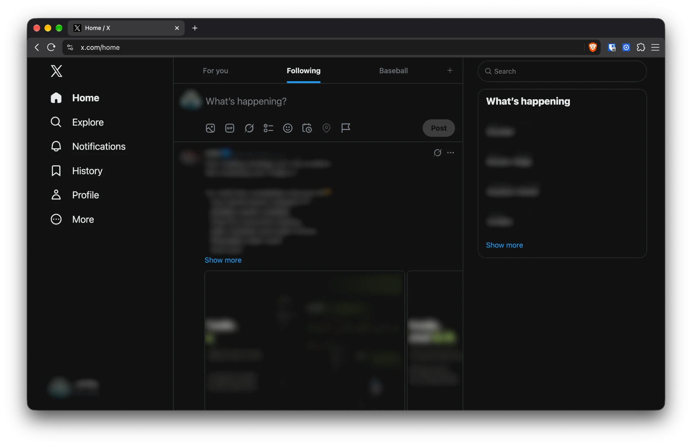
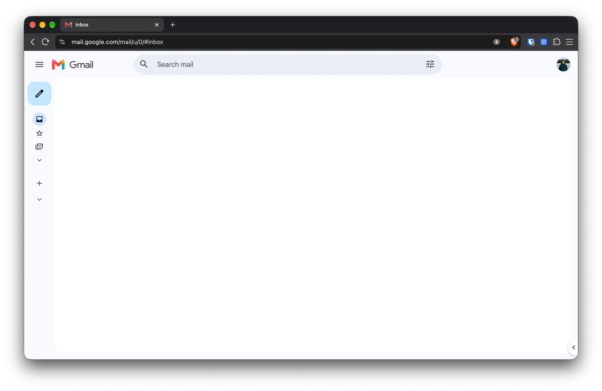

# Quiet Focus

Chromium extension (Manifest V3) that hides distracting elements on YouTube, Instagram, X, Gmail and TradingView. Works in Chrome, Edge and Brave.

More sites will be added over time.

## Screenshots

## What it can do

Options are grouped by where they sit on the page: Top, Left, Center, Right, Bottom and General. Every site has a **background colour** choice (light or dark theme), set per site.

**YouTube**
- Left: Shorts, the Explore and "More from YouTube" sections, Report history, the footer.
- Center: the Shorts shelf and the "Your watch history is off" message.

**X**
- Sidebar: hide any link (Home, Explore, Grok, Premium…), the Post button, or show icons only.
- Right column: Premium card, What's happening, Who to follow, footer, search box.
- Home: the post box and the "For you" tab.
- Posts: hide reply/repost/like/view counts (icons only).
- Floating Grok and Messages buttons.
- Appearance: remove divider lines, use the system font.
- Privacy: screenshot mode (blurs names, faces and post content).

**Instagram**
- Sidebar: Home, Search, Explore, Reels, Messages, Notifications.
- Feed: always open "Following" (the For you / Following tabs are hidden), stories, like and comment counts.
- Right column: "Suggested for you" and the footer.
- Privacy: screenshot mode (blurs names, faces and post content).

**Gmail**
- Top bar: Help, Settings, Gemini, Upgrade and Google apps buttons.
- Tab title: show only the folder name (hides your email address).
- Sidebar: Compose button, any folder link (Starred, Sent, Drafts…), unread counts.
- Inbox: toolbar, category tabs, split pane and input tools buttons, the "No new mail!" message, the footer.
- Right side panel (Calendar, Keep, Tasks…).

**TradingView**
- Top: symbol search, chart type, compare (+), Indicators, Alert, layout, Charts (save/load), quick search, chart settings, publish idea; Replay shown as an icon only.
- Right: products menu (grid) and Help buttons.
- Bottom: date ranges (1D… All) and Go to date; the bottom bar can show only the clock.

## Install

1. Open `chrome://extensions` (or `edge://extensions`, `brave://extensions`).
2. Turn on **Developer mode**.
3. Click **Load unpacked** and pick this folder.

After changing any file, click **Reload** on the extension and reload the site's tab.

## Using it

- Each site is a collapsible section in the popup, with a count of active options; the site of the current tab opens by default.
- Each site has its own on/off switch in its header.
- A switch that is **on** hides that element.
- The master switch at the top pauses everything without losing the individual settings.
- Settings live in `chrome.storage.sync`, so they follow your browser profile.
