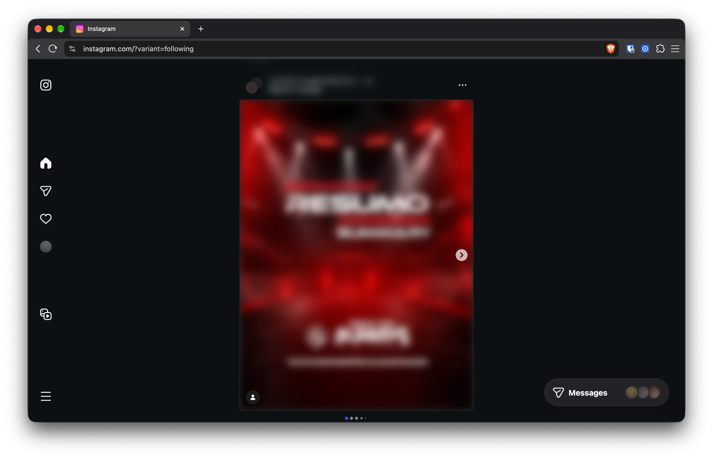

# Quiet Focus

Chromium extension (Manifest V3) that hides distracting elements on Instagram and X (YouTube is set up, with no options yet). Works in Chrome, Edge and Brave.

## Screenshots

Taken with **Screenshot mode** on, which blurs names, faces and post content.




## What it can do

**X**
- Sidebar: hide any link (Home, Explore, Grok, Premium…), the Post button, or show icons only.
- Right column: Premium card, What's happening, Who to follow, footer, search box.
- Home: the post box and the "For you" tab.
- Posts: hide reply/repost/like/view counts (icons only).
- Floating Grok and Messages buttons.
- Appearance: remove divider lines, use the system font, pick a dark background colour.
- Privacy: screenshot mode (blurs names, faces and post content).

**Instagram**
- Sidebar: Home, Search, Explore, Reels, Messages, Notifications.
- Feed: always open "Following" (the For you / Following tabs are hidden), stories, like and comment counts.
- Right column: "Suggested for you" and the footer.
- Privacy: screenshot mode (blurs names, faces and post content).

## Install

1. Open `chrome://extensions` (or `edge://extensions`, `brave://extensions`).
2. Turn on **Developer mode**.
3. Click **Load unpacked** and pick this folder.

After changing any file, click **Reload** on the extension and reload the site's tab.

## Using it

- Each site is a collapsible section in the popup, with a count of active options; the site of the current tab opens by default.
- A switch that is **on** hides that element.
- The master switch at the top pauses everything without losing the individual settings.
- Settings live in `chrome.storage.sync`, so they follow your browser profile.

## How it works

- `selectors.js` — every option, grouped by site. Each one gets its own control in the popup.
- `content.js` — runs at `document_start`, injects a `<style>` for the active options and updates live (`storage.onChanged`). Options with `match` or `redirect` start a `MutationObserver`.
- `popup.*` — the menu, built from `selectors.js`.

## Adding an option

In `selectors.js`, at the end of the site's `options`:

```js
{
  id: "shorts",                 // unique within the site
  group: "Sidebar",             // sub-heading in the popup
  label: "Shorts",
  default: false,               // on (hidden) unless set to false
  css: ['a[href^="/shorts"]'],  // hidden with display: none
},
```

Other optional fields:

- `rules: ['sel { ... }']` — raw CSS, to resize instead of hiding.
- `choices: [{ value, label }]` — a dropdown instead of a switch; `rules` becomes `(value) => [...]`.
- `match: (root) => [elements]` — when CSS is not enough (e.g. finding elements by text).
- `redirect: (url) => "new url" | null` — send the page elsewhere (e.g. always the Following feed).

A site's `groups: [...]` sets the order of its sub-headings.

Prefer `aria-label`, `data-testid`, `href` and stable ids; avoid auto-generated classes. Labels shown by the site follow its language, so list English and Portuguese where they are used.
