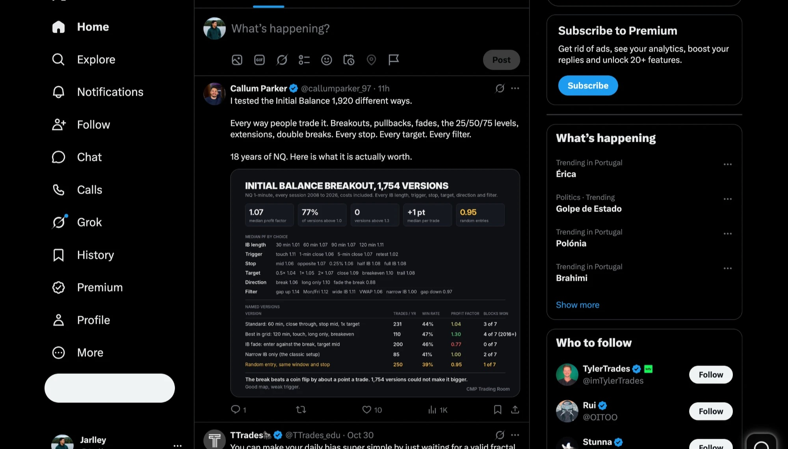
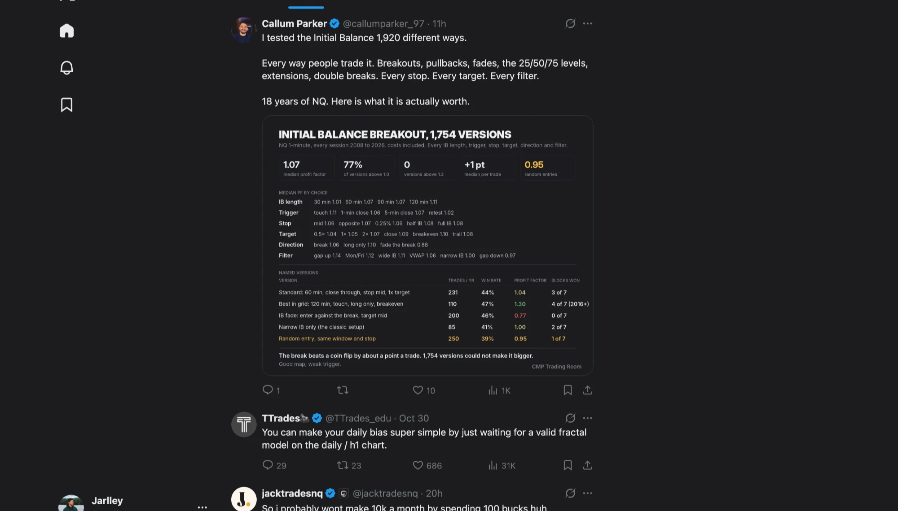
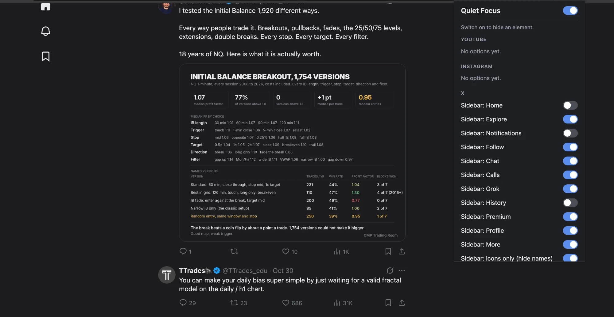
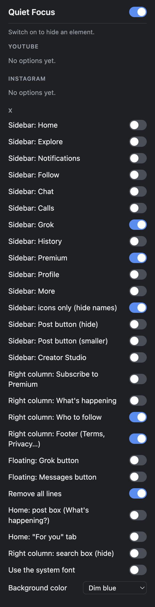

# Quiet Focus

Chromium extension (Manifest V3) that hides distracting elements on YouTube, Instagram and X. Works in Edge, Brave and Chrome.

## Screenshots

**Before** — X as it is by default:



**After** — icons-only sidebar, no post box, no right column, no divider lines, a dim background:



**The popup** next to the page, and the full list of options:





## Install

1. Open `edge://extensions` (Edge) or `brave://extensions` (Brave).
2. Turn on **Developer mode**.
3. Click **Load unpacked** and pick this folder.

After changing any file, click **Reload** on the extension and reload the site's tab.

## How it works

- `selectors.js` — all selectors, grouped by site. Each option gets its own switch in the popup.
- `content.js` — runs at `document_start`, injects a `<style>` with `display: none !important` for the active options and updates live (`storage.onChanged`).
- `popup.*` — master switch + one group per site. State lives in `chrome.storage.sync`.

A switch that is **on** hides that element. The master switch pauses everything without losing the individual settings.

## Adding an element

In `selectors.js`, inside the right site:

```js
options: [
  { id: "shorts", label: "Shorts", css: ['a[href^="/shorts"]'], default: false },
],
```

Prefer `aria-label`, `data-testid`, `href` and stable ids; avoid auto-generated classes.
If CSS is not enough, an option accepts `match: (root) => [elements]`, which starts a `MutationObserver` only in that case.
